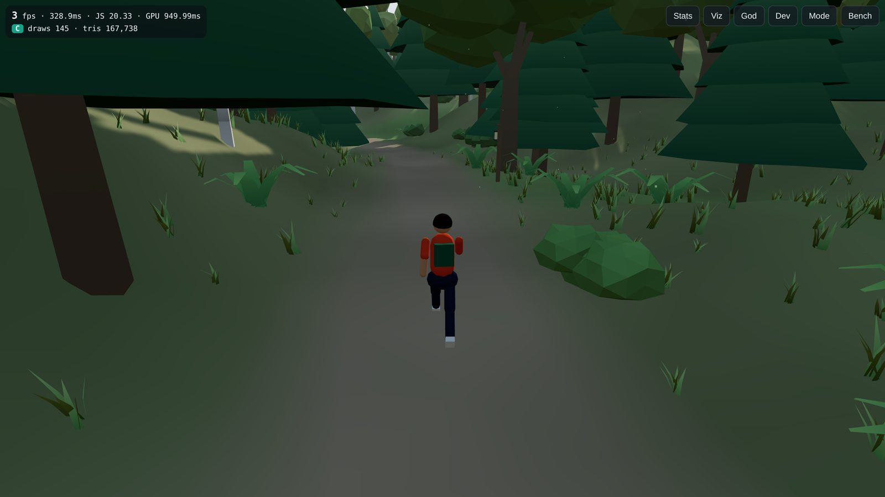
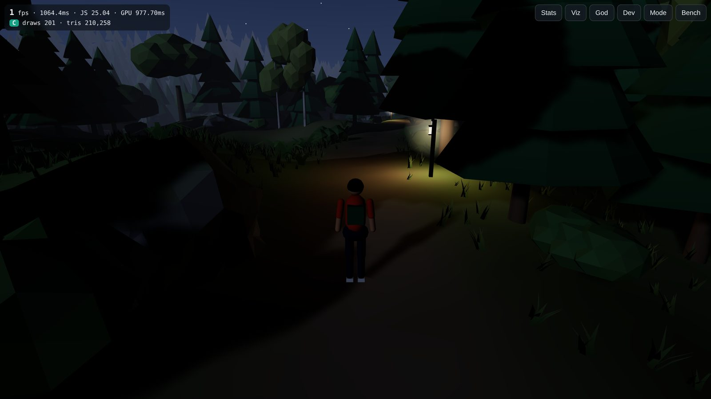
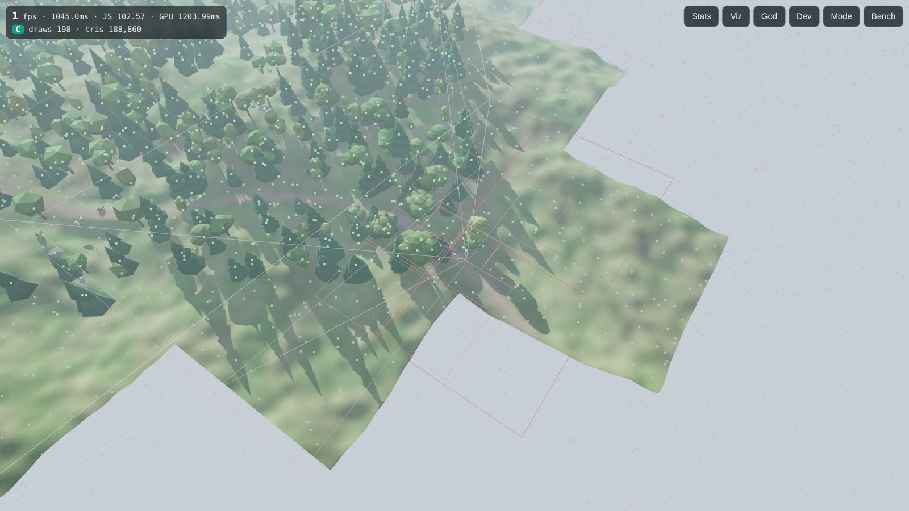
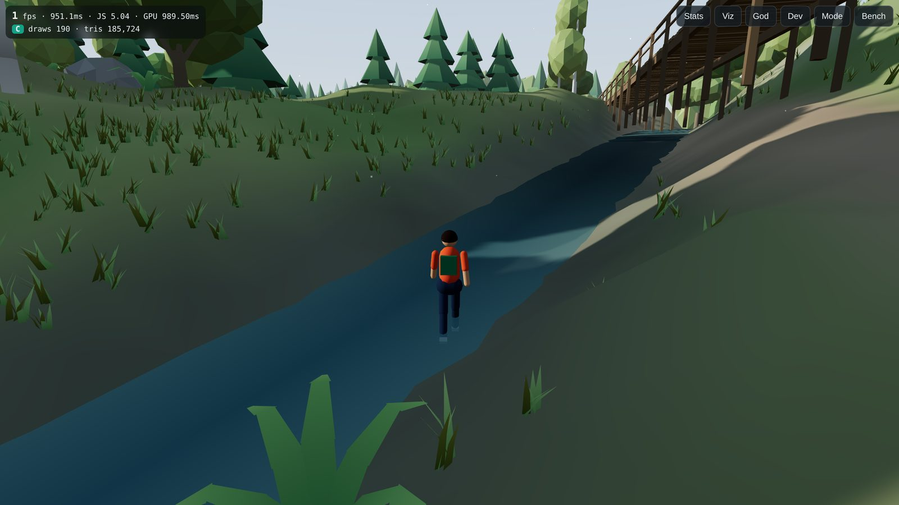
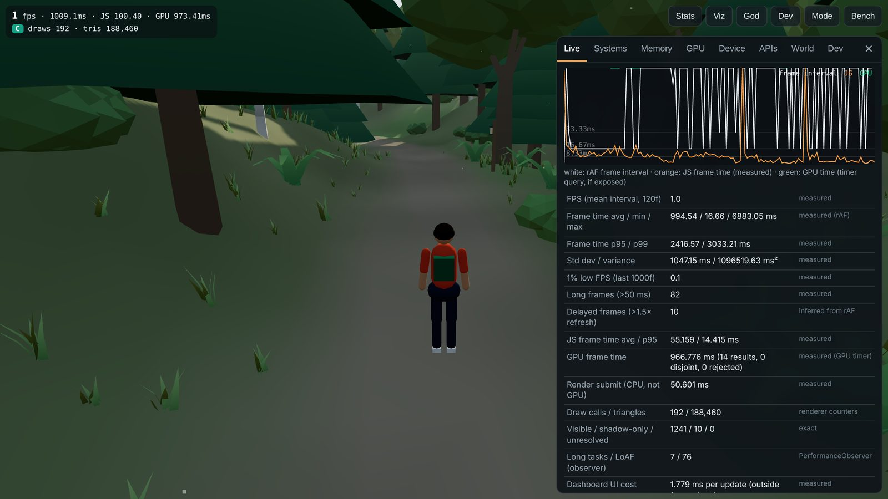
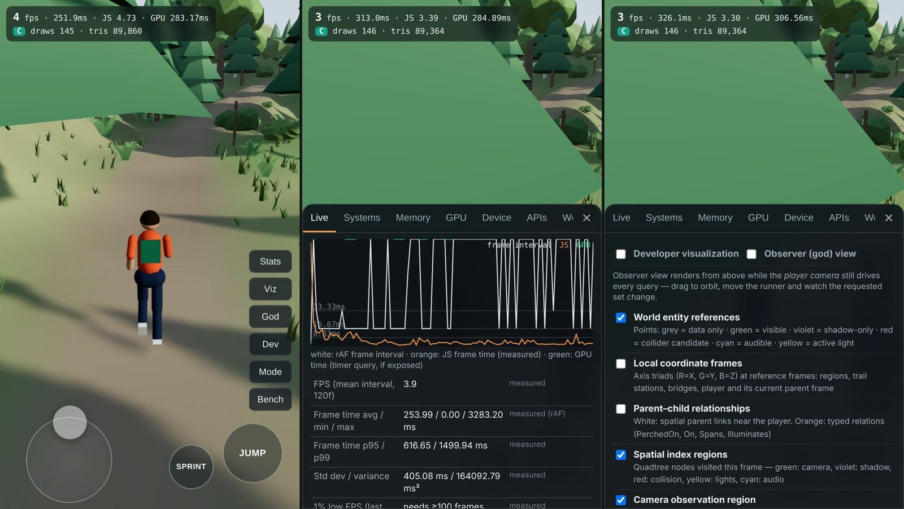

# Relational World Engine

**A camera-driven, demand-evaluated 3D world architecture — playable forest-running prototype with
extensive, honest performance instrumentation.**

The world exists as **data**: entity identities, typed relationships, local positional references
in hierarchical reference frames, procedural definitions, and material / physical / acoustic /
light descriptors. There is no permanently constructed scene. The camera, shadows, lighting,
physics and audio each *ask the world their own question* and keep their own representation;
the frame is assembled from their answers. Geometry is generated only when a consumer requests it.

| | |
|---|---|
|  |  |
|  |  |




*Screenshots were captured with headless Chromium and a software GPU; the frame rates shown in
the HUD reflect that rasterizer, not real hardware.*

* [What is implemented](#what-is-implemented)
* [Run it (desktop)](#run-it-desktop) · [Run it on an iPhone](#run-it-on-an-iphone)
* [Controls](#controls)
* [How the architecture works](#how-the-architecture-works) (full detail: [docs/ARCHITECTURE.md](docs/ARCHITECTURE.md))
* [Developer visualization](#developer-visualization)
* [Diagnostics dashboard & metric provenance](#diagnostics-dashboard)
* [Benchmarks](#benchmarks) · [Measured results](#measured-results-in-this-environment)
* [Bottlenecks](#biggest-measured-bottlenecks) · [Limitations](#limitations--compromises) · [Next steps](#what-to-investigate-next)
* Browser/iOS limitations: [docs/BROWSER_LIMITATIONS.md](docs/BROWSER_LIMITATIONS.md)

---

## What is implemented

| Requirement | Where |
|---|---|
| World database (identities, relationships, local references, state, procedural defs, materials, physical/acoustic/light properties; no stored geometry) | `src/world/WorldDatabase.ts`, `src/world/types.ts`, `src/world/WorldGenerator.ts` |
| Relational spatial system: parent-relative, grounded (terrain-relative) and curve-relative (trail) frames, rotation, reference changes, relationship updates, version-cached resolution | `src/world/FrameSystem.ts`, `src/world/Curve.ts` |
| Analytic terrain *field* (no collision mesh, no stored heights) | `src/world/TerrainField.ts` |
| Spatial discovery: loose quadtree with per-node flag masks & Y-ranges, naive full scan for comparison, lazy re-indexing driven by frame changes, cached query results with quadrant-level dependency invalidation | `src/spatial/*` |
| Independent systems: visibility, shadow contribution (incl. off-screen casters), lighting (sun/sky/fog + local-light pool), collision & physics (own analytic representation), audio positioning (WebAudio, procedural sounds), geometry evaluation | `src/systems/*`, `src/geometry/*` |
| Demand-driven rendering with time-budgeted generation, LOD fallback, unresolved tracking, shadow-only layer, instance caches | `src/render/RelationalPresenter.ts`, `src/geometry/GeometryStore.ts` |
| Conventional baselines (A: scene graph, A2: static batching) from the same data and generators | `src/render/ConventionalPresenter.ts` |
| Playable third-person runner: procedural humanoid (walk/run/jump/land animation), collision, follow camera with trunk occlusion, touch joystick + look + buttons, keyboard/mouse | `src/render/Character.ts`, `src/game/*`, `src/systems/PhysicsSystem.ts` |
| Forest: winding 1.5 km loop trail, stream with wooden bridges, ~7.5 k trees (pine/oak/birch), rocks, bushes, ferns, grass, lanterns, sun & dynamic shadows, sky, fog, dust motes / fireflies, time of day | world + render |
| Developer visualization (11 toggles + observer/god view) | `src/debug/DebugViz.ts` |
| Diagnostics dashboard (live, history graphs, subsystems, memory, GPU, device, APIs, world) | `src/ui/Dashboard.ts`, `src/diagnostics/*` |
| Benchmark suite A/A2/B/C, camera sweep, static, ablation, instrumentation overhead, stress D | `src/bench/Benchmark.ts` |
| CSV / JSON / device-report export, reset, run again — all local | Export tab, `src/diagnostics/Export.ts` |
| Tests (25 unit/integration tests) + Node data-layer benchmark | `tests/*`, `scripts/node-bench.ts` |

Stack: **TypeScript 5.9 + Vite 7 + Three.js r187 (WebGL2 backend)**; experimental optional
WebGPU backend via `three/webgpu` (`?backend=webgpu`). Three.js is used only to submit draw
batches — it does not hold the world.

---

## Run it (desktop)

```bash
npm install          # .npmrc sets legacy-peer-deps (works around an npm 10 peer-resolution bug)
npm run dev          # http://localhost:5173  (also printed: a Network URL for phones)
npm test             # unit + integration tests (vitest)
npm run build        # type-check + production build into dist/
npm run preview      # serve dist/ on :4173 (no hot reload — use this for benchmarks)
npm run bench:node   # data-layer micro-benchmark in Node (index vs scan, cached vs uncached)
```

URL parameters: `?arch=A|A2|B|C` (initial architecture, default C), `?quality=mobile|desktop`,
`?backend=webgpu` (experimental), `?autobench=compare&frames=300` (run a suite on load).

Both dev and preview servers send COOP/COEP headers so Chromium is cross-origin isolated
(5 µs timer resolution instead of 100 µs). The app makes **no network requests** at runtime.

## Run it on an iPhone

1. Put the computer and the iPhone on the **same Wi-Fi network**.
2. On the computer: `npm install && npm run build && npm run preview`
   (or `npm run dev` for live editing). Both listen on all interfaces and print a
   `Network: http://192.168.x.y:4173/` URL. Allow incoming connections if the OS firewall asks.
3. On the iPhone open that URL in **Safari**.
4. For a full-screen experience: **Share → Add to Home Screen**, then launch it from the home
   screen icon (standalone mode; iPhone Safari has no Fullscreen API for canvas).
5. Tap **Start with sound** (iOS requires a user gesture for Web Audio) or **Start silent**.
6. For benchmarks: keep the phone plugged in, disable Low Power Mode (it caps rAF at 30 Hz),
   keep the screen awake, close other tabs, and use `npm run preview` (no hot-reload client).

Notes:
* Requires **iOS 15 or newer** (Three.js r187 needs WebGL 2).
* **Not yet run on a physical iPhone.** In the development container it was checked with
  Chromium's iPhone 13 emulation (viewport, DPR, real touch events driving the joystick, panel
  layout). WebKit-specific behaviour (Safari's timer coarsening, memory limits, the silent
  switch and Web Audio) has not been exercised. The APIs tab reports what the phone actually
  exposes.
* Plain-HTTP LAN URLs are **not a secure context**: WebGPU and cross-origin isolation are
  unavailable there. Everything else works. For WebGPU on iOS, serve `dist/` over HTTPS
  (any static host you control, or a local HTTPS proxy) and append `?backend=webgpu`.
* The "mobile" quality preset is selected automatically on phones (1024² shadow map, max
  DPR 2, lighter grass, LOD scale 0.85, 3 ms geometry budget). Adjust in **Dev → Quality**.

## Controls

| Touch (iPhone) | Desktop |
|---|---|
| Left half: virtual joystick (push far = run, small = walk) | WASD / arrows (C or Alt = walk) |
| Right half: drag to look | Mouse drag to look, wheel to zoom |
| **JUMP** button | Space |
| **SPRINT** toggle | Shift |

Toolbar: **Stats** (diagnostics) · **Viz** (architecture overlay) · **God** (observer view) ·
**Dev** (overlay toggles, time of day, quality, invalidation demo) · **Mode** (architecture A/A2/B/C
or custom flags, instrumentation switches) · **Bench** (benchmarks). Tap the HUD to expand it.

---

## How the architecture works

1. **The world database is the only source of truth.** Struct-of-arrays entity table:
   kind, flags (which systems may care), parent frame, frame mode, local reference
   (8 floats), shape scale, bounds hints, references to descriptor tables, state.
   Relationships are a typed edge list (`Bridge Spans Stream`, `Lantern On Trail@s`,
   `Bird PerchedOn Tree`, …). ~13.8 k entities and ~14.3 k relationships build in ~90 ms —
   with zero geometry.
2. **Positions are relational.** A tree stores `(x, z)` in its 64 m region frame and *no
   elevation* — its height comes from the terrain field when resolved. The runner stores
   `(s, lateral, height)` along the trail while on it, switches to the bridge frame on a
   bridge, and to the region frame off-trail (each switch is a *reference change* preserving
   the world pose). World transforms are derived on request and cached by version
   (parent version, local version, terrain version).
3. **Discovery, not search.** Every system asks spatial questions through `Discovery`
   (frustum / sphere / AABB with a flag filter). The loose quadtree prunes by bounds *and* by
   flag masks; a naive full scan is available for comparison and is tested to return identical
   results. Query results are cached with dependency versions per quadrant.
4. **Independent systems** answer their own questions with their own representations:
   visibility (frustum + LOD), shadow contributors (receiver region swept toward the sun —
   finds off-screen casters), lighting (time-of-day sun/sky/fog; local lights ranked into a
   fixed pool of 4), physics (analytic cylinders/spheres/deck on the analytic terrain field),
   audio (ranked emitters into 6 WebAudio voices).
5. **Demand-driven rendering.** The presenter requests a representation per (definition, LOD)
   for each requested entity; missing ones are generated nearest-first under a per-frame time
   budget (LOD fallback meanwhile; still-missing entities are counted as *unresolved*).
   Draw batches: one instanced batch per (archetype, LOD) for the camera pass, one per
   (archetype, LOD) on a **shadow-only layer** for off-screen casters, pooled unique meshes
   for terrain/water/bridges, one grass batch from 8 m cells.

Architectures you can switch between at runtime (**Mode** tab, or `?arch=`):

| Mode | Meaning |
|---|---|
| **A** | Conventional scene graph: all geometry prebuilt; one `THREE.LOD` + meshes per entity under region groups; Three.js traversal, per-object culling, LOD, shadow pass. |
| **A2** | Conventional static batching: prebuilt `InstancedMesh` per (region, archetype, LOD) with region-level LOD — a strong conventional baseline. |
| **B** | Relational, uncached: full-chain reference resolution on every request, full scans for every query, no query cache, geometry kept only while observed. |
| **C** | Relational + cached reference resolution + spatial index + query cache + LRU geometry cache + cached instance transforms + skip-unchanged assembly. |
| custom | Any combination of the C optimizations (ablation). |

---

## Developer visualization

Open **Dev** (or tap **Viz**). Toggles (each uses its own color language):

| Toggle | What you see |
|---|---|
| World entity references | One point per entity: grey = exists only as data, green = visible, violet = shadow-only contributor, red = collider candidate, cyan = audible, yellow = active light |
| Local coordinate frames | Axis triads at region frames, trail stations, bridges, the player and its current parent frame; trail-relative station of the player |
| Parent–child relationships | Spatial parent links near the player (white), typed relations (orange) |
| Spatial index regions | Quadtree nodes visited this frame, colored by the querying system |
| Camera observation region | Player-camera frustum (white), shadow receiver region (violet) |
| Light influence regions | Influence spheres (selected vs considered), sun direction |
| Shadow contributors | Light-direction rays from off-screen casters, candidate search box |
| Collision queries | Broadphase box, candidate analytic colliders, contact normals |
| Generated / Cached / Unresolved geometry | Green = generated in the last second, blue = served from cache, grey = requested but not yet generated |

**God** switches to an observer camera above the runner while the *player camera still drives
every query*. Drag to orbit; run around and watch terrain patches, trees and shadow-only
casters appear and disappear. Shadow-only casters are rendered visibly in the observer view
(they are normally only in the shadow map), so you can see trees that exist solely because
their shadow falls into the view.

**Dependency invalidation demo:** *Nudge region ahead* moves one region frame by 2 m. Every
descendant re-resolves (trees re-ground on the terrain), is re-indexed, and only cached queries
touching that quadrant are invalidated (watch the Systems tab counters).

---

## Diagnostics dashboard

Tabs: **Live** (frame-time graph, FPS, avg/min/max/p95/p99, variance, 1% low, long and
delayed frames, JS vs GPU time, subsystem bars) · **Systems** (every subsystem timer, work
counters, cache hit rates, profiler overhead) · **Memory** · **GPU** · **Device** · **APIs** ·
**World** (entity counts, player reference frame, world rebuild with density/stress) · **Dev** ·
**Mode** · **Bench** · **Export**.

### Metric provenance (what is real, what is estimated)

| Metric | Source | Label in UI |
|---|---|---|
| Frame interval, FPS, min/max/p95/p99, variance, 1% low (≥100 samples), long frames | `requestAnimationFrame` timestamps | measured |
| Delayed frames | interval > 1.5 × refresh estimate | inferred from rAF |
| JS frame time, every subsystem time, geometry generation time | `performance.now()` around code blocks | measured (quantized by timer resolution — shown) |
| "Render submit (CPU)" | `performance.now()` around `renderer.render()` | measured — **CPU submission, not GPU execution** |
| GPU frame time | `EXT_disjoint_timer_query_webgl2` (async, attributed to the issuing frame; disjoint/implausible results discarded) | measured, or **"unavailable — reason"** |
| Draw calls, triangles, points, lines, programs, textures, geometries | Three.js renderer counters (`renderer.info`, includes the shadow pass) | renderer counters |
| WebGL draws/instances/program switches/upload bytes | optional wrapper around the GL context | exact counts (adds overhead; off by default) |
| Queries, nodes visited, objects tested, resolutions, recomputes, cache hits/misses, geometry generated/evicted, unresolved, instances written, upload bytes | engine counters | exact |
| JS heap used/total/limit | `performance.memory` (Chromium only) | browser-reported or "not exposed" |
| GC events | drops > 1 MB in `usedJSHeapSize` | inferred |
| Entity table, frame cache, index, generated geometry (CPU), instance buffers | byte length of typed arrays allocated by the engine | exact (allocated bytes) |
| GPU geometry memory, shadow map, drawing buffer | derived from uploaded sizes / dimensions | **estimate** |
| Refresh rate | median rAF interval over 90 frames | estimate |
| Profiler overhead | calibrated cost of one begin/end pair × pairs per frame | estimate; the **overhead benchmark** measures it directly |

Device/API report: UA, browser, OS, screen, viewport, DPR, hardware concurrency, device-memory
hint, touch, WebGL version/limits/extensions, unmasked GPU strings (if exposed), WebGPU adapter
info/features, timer resolution, cross-origin isolation, PerformanceObserver entry types,
Resource Timing — and an explicit list of iOS/Safari restrictions when detected.

The instrumentation can be switched off (**Mode → Per-subsystem profiler**); the whole-frame
timer (2 `performance.now()` calls) always stays on so runs remain comparable.

---

## Benchmarks

Open **Bench**, choose a suite, set frames/density (and stress steps for D), press **Run**.
**Run again** repeats the last suite; **Reset results** clears the table. Results show FPS,
1% low, frame time, JS time (with Δ vs the first row), GPU time, draws, triangles, visible /
shadow-only counts, unresolved fraction, queries & query-cache hit rate, geometry generated,
heap and estimated geometry memory. Export the full results (every per-frame sample, device
report, methodology) as JSON from **Export**.

| Suite | Content |
|---|---|
| **A / A2 / B / C comparison** | Same world, same scripted trail run, each architecture (TEST A, B, C). |
| **Camera direction sweep** | Fixed position, 360° camera orbit, results per 45° sector (A2 vs C). |
| **Static camera** | Cache effectiveness & per-frame traversal cost with no motion. |
| **Ablation** | C with each optimization removed in turn. |
| **Instrumentation overhead** | C with the profiler on vs off. |
| **D · Stress** | Progressive steps adding off-camera trees (default 0 / 15 k / 40 k), tall shadow casters and extra lights; dusk; 360° sweep per step; selectable architectures. |

Reproducibility: fixed world seed; **fixed 1/60 s simulation step per frame** (camera poses are
a function of the frame index, not wall time — identical across devices and frame rates);
scripted trail-relative camera paths; cold caches at scenario start; warm-up frames reported
separately; identical resolution, quality settings and content per scenario. If the median
frame interval equals the refresh interval the result is flagged **vsync-capped** — compare JS
and GPU time instead of FPS.

---

## Measured results (in this environment)

> **Read this first.** These numbers come from the development container, **not from an iPhone**:
> headless Chromium 153 (Playwright) rendering through **SwiftShader, a software rasterizer**, on a
> shared 4-vCPU Linux VM; DPR 1; desktop quality preset; viewport 960×540 (comparison) or
> 640×360 (other suites); cross-origin isolated (timer resolution 5 µs). SwiftShader exposes GPU
> timer queries, but they time CPU-emulated rasterization (≈200–500 ms per frame), so the frame
> rate (1–5 FPS) is render-bound and says nothing about real GPUs. **The main-thread JS times
> are the meaningful signal here**, as relative comparisons on one CPU. `performance.memory`
> stayed at a constant 9.5 MB in every run (Chromium caches it), so browser heap is **not
> reported**; the memory column is the engine's own estimate. Runs were single runs per
> scenario: across repeated rounds the same scenario varied by up to ~±10%, so smaller
> differences are noise. The final terrain fix near bridges (embankments) landed after these
> runs; it changes a few terrain patches and no workload code. Raw JSON (every per-frame sample
> plus the device report) is in [`docs/results/`](docs/results/); regenerate tables with
> `python3 scripts/results-to-markdown.py docs/results compare ablation sweep static stress overhead`.

**TEST A / A2 / B / C — same world (13 840 entities), same scripted trail run, 180 frames after a 90-frame cold warm-up**

| | A · scene graph | A2 · static batching | B · relational, uncached | C · relational, cached + indexed |
|---|---|---|---|---|
| JS frame time, mean (p95) | 56.5 ms (76.6) | 15.7 ms (21.4) | 26.5 ms (36.1) | **2.67 ms (4.80)** |
| Largest measured parts | Three.js scene update 19.4 + render submit 36.8 | scene update 5.9 + submit 9.6 | **reference resolution 22.8** (inside visibility 10.1, shadow 7.4, physics 5.8) | render submit 1.64 · assembly 0.38 · visibility 0.21 · shadow 0.09 |
| Draw calls (incl. shadow pass) | 1 681 | 528 | 174 | 174 |
| Triangles | 409 k | 566 k | 165 k | 165 k |
| Transform recomputes / frame | – | – | 133 405 | 1.6 |
| Frames with unresolved geometry | 0 % | 0 % | 1.1 % | 0 % |
| Geometry + instance memory (estimate) | 50.6 MB | 52.6 MB | 3.9 MB | 6.8 MB |
| Up-front scene build | 1.52 s | 1.17 s | world *data* 0.09 s (no geometry) | same |
| Warm-up (first 90 frames, cold) | 56.9 ms JS | 16.6 ms | 28.5 ms | 4.1 ms; 124 representations generated, 78 entities/frame still unresolved on average |

What this does and does not show:
* **The relational representation alone was not faster.** Uncached (B) was slower than the
  conventional static-batching baseline (A2): 26.5 vs 15.7 ms, nearly all of it re-resolving
  transforms during full scans.
* With caching and indexing (C), main-thread JS per frame was **~6× lower than A2 and ~21×
  lower than A**, with 3× fewer draw calls than A2 and 0.29× its triangles for the same content.
  Part of that is how C batches (one instanced batch per archetype × LOD, entity-level LOD),
  not only how it stores the world.
* GPU cost on real hardware was **not measured** (software rasterizer). A2 draws 3.4× C's
  triangles; whether that matters on an iPhone GPU has to be measured on the device.

**Ablation — C with one optimization removed (trail run, 150 frames)**

| Variant | JS mean (p95) | Δ vs C | Notes |
|---|---|---|---|
| C (all on) | 2.60 ms (5.12) | | repeat rounds: 2.67 / 2.57 / 2.60 |
| − cached reference resolution | 3.50 ms (6.08) | **+35 %** | assembly re-composes matrices: 0.37 → 1.25 ms |
| − spatial index (full scans) | 2.90 ms (4.37) | +11 % | repeat rounds: +18 % / +43 % / +11 % at 13.8 k entities |
| − query cache | 2.52 ms (4.71) | −3 % (noise) | **before a fix it was −14 %**: storing exact-frustum results every moving frame cost more than it saved; results are now stored only once the view repeats |
| − geometry cache | 2.52 ms (5.00) | −3 % (noise) | 0.7 % of frames unresolved, 2× the generations |
| − instance cache | 2.51 ms (4.63) | −3 % (noise) | its benefit is the still-camera path below |
| − prefetch | 2.16 ms (3.34) | **−17 %** | prefetch spends idle budget generating; it pays off when turning (sweep below) |

**Static camera (150 frames):** A 60.1 ms · A2 19.1 ms · **C 1.64 ms**. With the camera still, C
serves every query from cache, skips assembly entirely (0.01 ms) and uploads 0 KB of instance data.
Before a fix (the scripted runner was flagged as moved every frame) C was 2.06 ms with 0.38 ms
of assembly.

**Camera-direction sweep (fixed position, 360° in 240 frames, cold start)**

| | JS mean (p95) | Draws | Triangles | JS by direction (8 sectors) | Visible / shadow-only by direction | Frames with unresolved geometry |
|---|---|---|---|---|---|---|
| A2 | 22.1 ms (30.1) | 654 | 622 k | 18.9–21.7 ms (first sector 38 ms: shader warm-up) | n/a | 0 % |
| C | 3.22 ms (5.62) | 186 | 192 k | 2.48–4.12 ms | 496–1 302 / 4–227 | **16.7 %** (29.2 % before prefetch) |

Shadow-only contributors swing 4 → 227 depending on whether the camera faces away from or
toward the low sun: the shadow system is direction-dependent work by design.

**D · Stress — off-camera trees, tall casters and extra lights added per step; dusk; 360° sweep.**
This suite ran on the earlier build, before the query-cache, still-camera and prefetch changes.

| Step | Entities | A2 JS | A2 draws / triangles | C JS (by direction) | C draws / triangles | C visible / shadow-only | C unresolved frames |
|---|---|---|---|---|---|---|---|
| 0 | 14 050 | 18.2 ms | 677 / 0.62 M | 3.69 ms (2.5–5.9) | 191 / 0.19 M | 1 037 / 118 | 24.4 % |
| 1 (+15 k) | 29 260 | 20.8 ms | 724 / 1.14 M | 4.78 ms (3.2–6.9) | 194 / 0.35 M | 2 792 / 301 | 26.1 % |
| 2 (+40 k) | 54 470 | 21.3 ms | 731 / 1.99 M | 7.60 ms (4.3–10.9) | 195 / 0.60 M | 5 696 / 570 | 26.1 % |

A2's JS stays flat (cost follows the number of batches) while its triangles triple. C's draw
calls stay flat, but its JS grows with the number of *visible* entities. The extra trees were
placed uniformly, so many landed inside the view.

**Instrumentation overhead (C, trail run):** profiler on 2.56 ms vs off 2.35 ms → ≈0.2 ms/frame
(≈8 %, single run). The whole-frame timer stays on in both.

**Data layer only (Node 22, same container, `npm run bench:node`)** — ms per operation:

| Entities | Resolve all bounds: cached / uncached | Camera frustum query: index / scan (cached transforms) / scan (uncached) | Collision-sized sphere query: index / scan |
|---|---|---|---|
| 13 840 | 0.57 / 11.7 | 0.30 / 0.62 / 9.0 | 0.050 / 0.37 |
| 33 840 | 0.69 / 19.9 | 0.17 / 1.97 / 24.4 | 0.009 / 1.04 |
| 73 840 | 1.98 / 38.8 | 0.43 / 3.30 / 52.0 | 0.014 / 2.49 |
| 133 840 | 3.99 / 88.9 | 1.30 / 6.09 / 91.0 | 0.048 / 5.00 |

(The first row includes JIT warm-up effects. Indexed and scanned queries return identical sets;
see `tests/spatial.test.ts`.)

---

## Biggest measured bottlenecks

Ranked by measured cost in the runs above:

1. **Uncached reference resolution (B):** 22.8 of 26.5 ms per frame. Every full-scan query
   re-walks every parent chain and re-evaluates terrain height, for 133 k transform recomputes
   per frame. Version-checked caching is the single most valuable optimization (+35 % JS when
   only it is removed from C).
2. **Scene-graph traversal and submission (A):** 19–22 ms to update matrices and select LOD
   for 13.6 k `THREE.LOD` objects (~60 k scene objects), plus 37 ms of Three.js render
   submission (culling and sorting ~1.7 k draws).
3. **Region-granular LOD (A2):** 3.4× C's triangles (2 M at 54 k entities). Its GPU cost is
   unknown here but is the likely limit on a phone.
4. **In C, render submission dominates the CPU** (1.4–2.4 ms, ~60 % of JS). Three.js
   render-list work and WebGL calls are already the largest share.
5. **C's per-visible-entity work** (visibility refinement plus instance assembly) grows with
   what is in view: 7.6 ms at 5.7 k visible entities, 10.9 ms in the worst direction.
6. **Pop-in from demand-only generation:** with cold caches, fast camera turns left ≥ 1
   representation missing in 17 % of frames (29 % before prefetch). It comes from far terrain
   patches generated within a 4 ms/frame budget.
7. **Prefetch's own cost:** about 0.4 ms of idle generation per frame (−17 % JS when
   disabled) in exchange for less pop-in.
8. **Exact-observation query caching** only helps when the view repeats. Storing it while
   moving was a net cost until it was gated.
9. **Memory and startup of prebuilt scenes:** ~51–60 MB (estimated) of geometry and instance
   data, built in 1.2–1.6 s, versus 4–8 MB generated on demand.
10. **Instrumentation:** ~0.2 ms per frame.

---

## Limitations & compromises

Summarized here; details in [docs/ARCHITECTURE.md §7](docs/ARCHITECTURE.md#7-compromises-and-limitations-honest-list).

* Three.js requires a `THREE.Scene`; the presenter uses it as a flat, per-frame-refilled
  container of draw batches (presentation state only).
* Vegetation and rocks use 24 shared archetypes (26 with the lantern and stress pillar; 66 LOD meshes in total) + per-entity scale/yaw/shape/tint; grass is a per-patch
  procedural field, not entities.
* Terrain carving uses curve copies made at world build; moving the forest/trail frame would
  not re-carve terrain until rebuild.
* Test B keeps geometry while observed and shares the generation time budget, so it shows
  pop-in (reported as *unresolved*) rather than unbounded frame times.
* Conventional LOD distances are measured from object origins (THREE.LOD), ours from bounds
  centers; A2's region-level LOD draws more triangles than per-entity LOD.
* GPU time is only available where a timer-query extension exists (not on iOS).
* The WebGPU backend is experimental and was **not** exercised here (no WebGPU adapter in the
  container): wind/tint shader injection is WebGL-only and shadow-only layering relies on
  WebGL shadow-map semantics.
* Headless measurements in this repository were taken with a **software GPU (SwiftShader)** on
  a shared 4-core container — they validate the pipeline and the *relative CPU-side* behaviour,
  not iPhone performance. Run the suites on the target device.

---

## What to investigate next

1. **Run the suites on the target devices** (iPhone Safari, a desktop GPU). Safari exposes no
   GPU timer, so add an opt-in "forced sync" probe (1-pixel `readPixels` after render, clearly
   labeled wall-clock-with-stall) or use WebGPU timestamp queries where available.
2. **Move evaluation and generation off the main thread:** systems and the geometry evaluator
   are renderer-agnostic and work on typed arrays, so they can run in Workers over
   `SharedArrayBuffer` (needs HTTPS + cross-origin isolation). This would remove pop-in
   pressure and the render/evaluate serialization.
3. **Cut per-visible-entity cost:** cache instance blocks per index node (copy whole
   fully-inside nodes), reuse visibility between frames (re-test only nodes crossing frustum
   planes), and compact visible lists per archetype.
4. **GPU-driven culling and indirect draws (WebGPU):** upload entity bounds once, cull and LOD
   in a compute shader, and drop CPU instance writes.
5. **Predictive prefetch:** the runner moves along the trail in curve coordinates
   (`s`, ds/dt), so future observations are predictable. Prefetch along predicted `s` and
   adapt the generation budget to measured frame slack.
6. **Shadows:** cascaded shadow maps with per-cascade contributor queries and tighter
   caster-volume tests (the capsule test is conservative).
7. **Stronger baselines:** `BatchedMesh` with multi-draw, per-entity LOD with instancing, and
   chunked grass for A, so no conventional configuration is a strawman.
8. **More relational queries:** heightfield horizon occlusion (terrain hides most of the
   valley), and audio occlusion from the same analytic terrain.
9. **Memory:** compressed vertex formats (oct-encoded normals, half-float positions) and
   device-specific geometry budgets for iOS.
10. **Statistics:** repeated runs with confidence intervals, and an automated device matrix.

---

## Project layout

```
src/
  world/      WorldDatabase, types, FrameSystem, Curve, TerrainField, WorldGenerator
  spatial/    SpatialIndex (loose quadtree), Discovery (index | naive), QueryCache, Frustum
  systems/    Observation, Visibility, Shadow, Lighting, Physics, Audio
  geometry/   MeshBuilder, Generators (trees, rocks, ferns, lanterns, bridges, terrain, water, grass), GeometryStore
  render/     Stage (backend), Materials, RelationalPresenter, ConventionalPresenter, Character
  engine/     Engine (frame orchestration, architectures, scripted cameras)
  game/       Input (touch + keyboard/mouse), CameraController
  debug/      DebugViz
  diagnostics/ Profiler, FrameStats, GpuTimer, GLInstrument, DeviceInfo, PerfObservers, Export
  bench/      Benchmark suites & runner
  ui/         Dashboard, Graph
tests/        frames, spatial (index ≡ naive), systems (physics, shadows, geometry, cache, stats), bridge (world+physics integration)
scripts/      node-bench.ts, results-to-markdown.py
docs/         ARCHITECTURE.md, BROWSER_LIMITATIONS.md, screenshots/, results/ (raw benchmark JSON)
```
